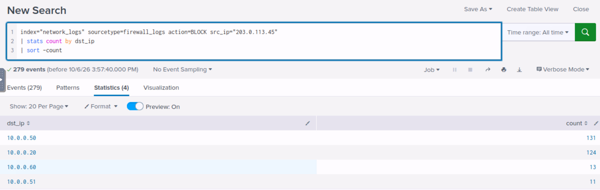
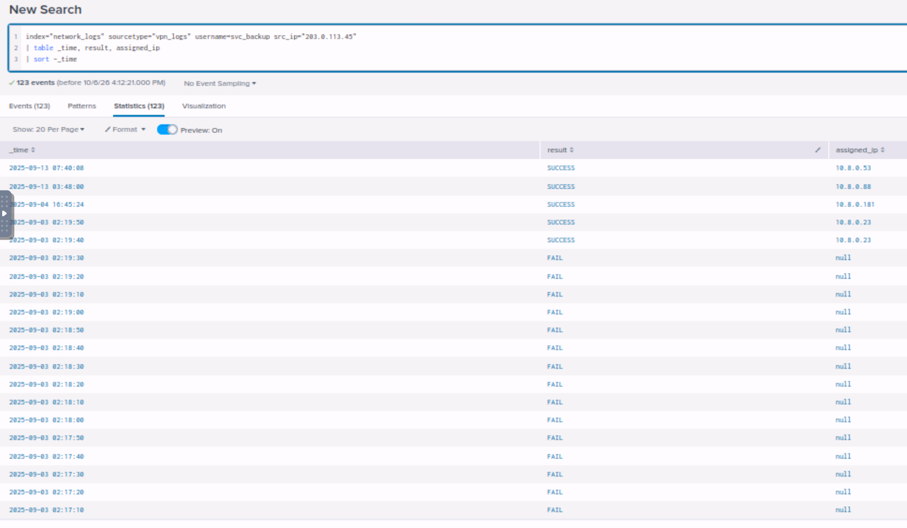
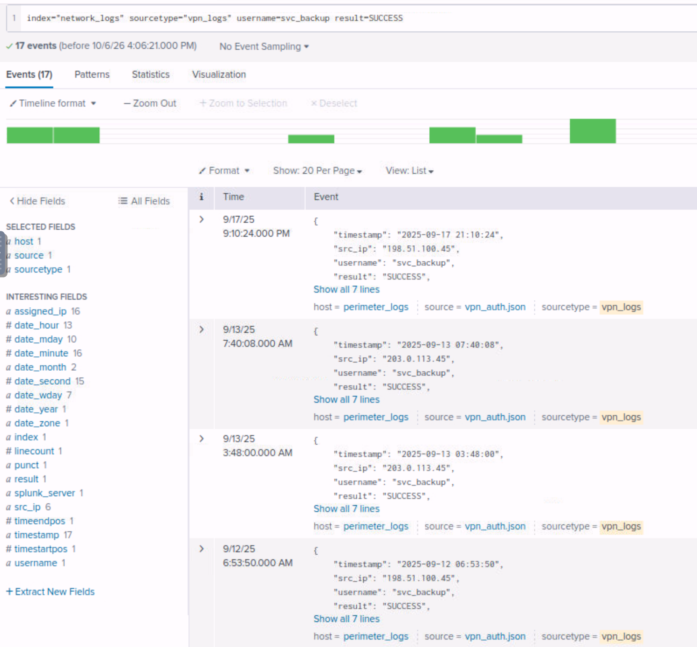
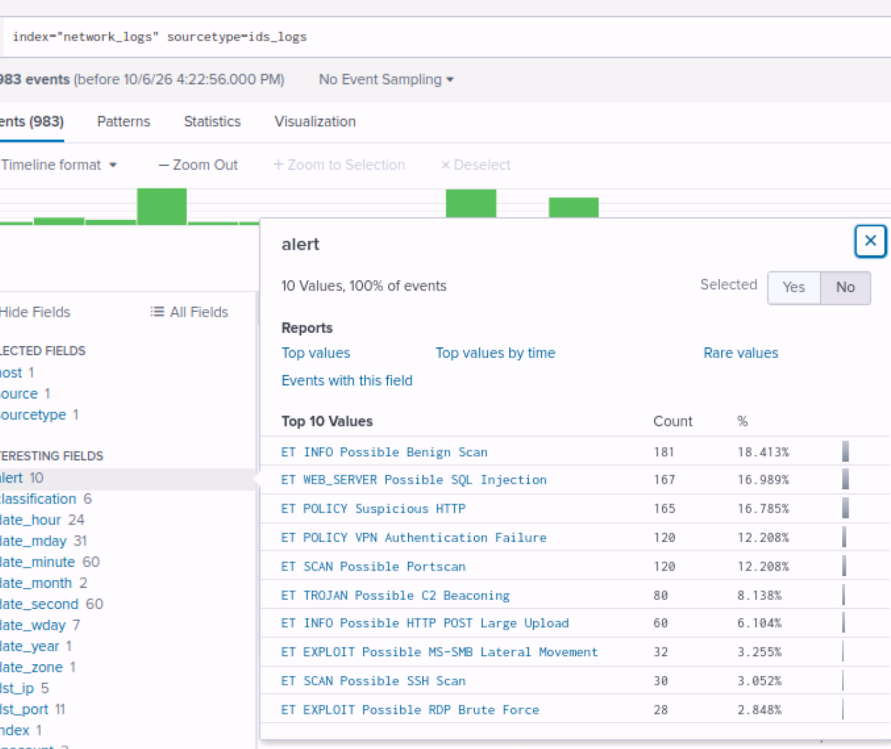

# Network Security Essentials — Initech Perimeter Breach Investigation

**Room:** [Network Security Essentials](https://tryhackme.com/room/networksecurityessentials)
**Path:** SOC Level 1 → Network Security Monitoring
**SIEM used:** Splunk (the room also gives the raw logs for grep/cut/sort/uniq)
**Date completed:** October 2026

## Scenario

Initech Corp is a mid-sized financial services company that recently put a new firewall and IDS on its perimeter. For a month the analysts noticed odd traffic but nobody had time to look deeper. I was given one month of perimeter logs from three sources and asked two things: what techniques did the adversary use, and did they get in.

The three logs, pre-ingested into Splunk under `index="network_logs"`:

| Sourcetype | Device that writes it | What it records | Question it answers |
|---|---|---|---|
| `firewall_logs` | Firewall | Every connection attempt with ALLOW or BLOCK | Who tried to talk to whom, and did it pass? |
| `ids_logs` | IDS (Suricata/Snort, Emerging Threats rules) | Only traffic that matched a signature | What attack was it? |
| `vpn_logs` | VPN gateway | Authentications only: source, user, result, assigned internal IP | Who got in, with which account, and what IP did they get inside? |

That table was the first thing I had to get straight. All three have timestamps and IPs, so at first they look interchangeable. They are not: the firewall records everything but does not judge it, the IDS judges but only writes when a rule matches, and the VPN log stops at the login. Each one is blind to what the other two see, and the investigation is a chain of pivots between them.

Network assets provided by the room:

| IP | Hostname | Role | Criticality |
|---|---|---|---|
| 10.0.0.20 | FINANCE-SRV1 | File/finance server (SMB) | High |
| 10.0.0.50 | VPN-GW | VPN gateway | Critical |
| 10.0.0.51 | APP-WEB-01 | Internal web/app | High |
| 10.0.0.60 | WORKSTATION-60 | Employee workstation (Sales) | Medium |
| 10.0.1.10 | DMZ-WEB | Public web server in the DMZ | Medium |
| 10.8.0.23 | VPN-CLIENT-ATTK | Ephemeral IP the VPN assigned to the attacker's session | Critical |

## Step 1: Reconnaissance in the firewall log

Blocked connections are the cheapest place to start, because a scanner leaves a pile of them. Grouping the BLOCK events by source:

```
index="network_logs" sourcetype=firewall_logs action=BLOCK
| stats count by src_ip | sort -count
```

One external IP, `203.0.113.45`, had 279 blocks, far above anything else. Pivoting on it to see what it was probing:

```
index="network_logs" sourcetype=firewall_logs action=BLOCK src_ip="203.0.113.45"
| stats count by dst_ip | sort -count
```



Four internal hosts, with the VPN gateway (131) and the finance file server (124) taking almost all of it, and the ports were the usual suspects: 21, 22, 23, 445, 3389. Same source, many destinations and many ports, spread out over days instead of fired in one burst. A port scan, and a patient one.

The firewall was doing its job here, but the same query with `action=ALLOW` showed the IP also had connections that went through, including some to the VPN gateway on 22 and 445. The perimeter was not sealed. Where it went from there is not in the firewall log, so the next stop was the VPN.

## Step 2: Brute force against the VPN

Counting failed authentications by source IP in the VPN log gave 118 failures for `203.0.113.45` and a single one for each of three other addresses. All 118 were against the same account, `svc_backup`. Laying them out in time:

```
index="network_logs" sourcetype="vpn_logs" username=svc_backup src_ip="203.0.113.45"
| table _time, result, assigned_ip | sort -_time
```



A FAIL every 10 seconds, exactly, for about 20 minutes on 2025-09-03, and then `SUCCESS` at 02:19:40 with `assigned_ip=10.8.0.23`. Ten seconds after the last failure. That is the password being guessed, by a script, and landing.

Two things I had to think through here:

- `svc_` is a service account: it belongs to a process (backups), not a person. That is exactly why it is a good target. Nobody notices it logging in at 2 AM, the password rarely changes, and it usually has broad access to the file servers it backs up.
- The credential and the assigned IP are different things. The username and password are the key; `10.8.0.23` is the seat the attacker occupies once inside. From this point on, `10.8.0.23` is the attacker's identity in the internal network, and it is the value to carry into the firewall log.

The account did not go quiet after that either. `203.0.113.45` logged in again as `svc_backup` on September 4 and twice on September 13, getting a different internal IP each time (`10.8.0.181`, `10.8.0.88`, `10.8.0.53`). And dropping the source IP from the search showed 17 successful `svc_backup` logins across the month from six different external addresses, `198.51.100.45` among them.



A backup service account authenticating to the VPN from half a dozen public IPs is wrong on its own, with or without the brute force. Either the credential was already circulating, or the account is used in a way nobody should have accepted. Either way, resetting it is the first containment action, not the last.

## Step 3: Lateral movement, seen from the firewall

With `10.8.0.23` as the source in the firewall log:

```
index="network_logs" sourcetype=firewall_logs src_ip="10.8.0.23" action=ALLOW
| stats count by dst_ip, dst_port | sort -count
```

Starting 2025-09-05 at 06:00, a connection roughly every ten minutes to `10.0.0.20`, `10.0.0.51` and `10.0.0.60`, rotating through ports 445 (SMB), 3389 (RDP) and 22 (SSH). Three machines, three services on each. The attacker was trying every door on every building it could reach, and the firewall was letting the traffic through because it was internal to internal.

This is also the clearest example in the exercise of why the three logs are needed together. The VPN log ends at the login, so it cannot show this. The IDS only fires on signatures, so it shows a subset of it. The firewall is the only source that records every attempt, which is how the full list of probed hosts and ports came out.

## Step 4: What the IDS called it

The same IP in `ids_logs` gave names to those connections:

```
index="network_logs" sourcetype=ids_logs src_ip="10.8.0.23"
| stats count by alert | sort -count
```

`ET SCAN Possible SSH Scan`, `ET EXPLOIT Possible MS-SMB Lateral Movement`, `ET EXPLOIT Possible RDP Brute Force`, all Priority 1. The SMB one is the one that matters: the only SMB server in the asset list is FINANCE-SRV1, a Windows file server, and the host knocking on 445 was already holding valid credentials.

Looking at the full alert distribution for the month put the incident in proportion:



The noisy categories (benign scans, SQL injection attempts against the web server, suspicious HTTP) are the background of any internet-facing network. The ones that tell the story of this breach are smaller: 120 VPN authentication failures, 80 C2 beaconing alerts, 60 large HTTP POST uploads, 32 SMB lateral movement alerts.

## Step 5: Command and control

`ET TROJAN Possible C2 Beaconing` was the alert I went to next. Grouping by source:

```
index="network_logs" sourcetype=ids_logs alert="ET TROJAN Possible C2 Beaconing"
| stats count by src_ip, dst_ip, dst_port
```

The beaconing host was not the VPN client. It was `10.0.0.60`, WORKSTATION-60, one of the three machines probed in step 3. From 2025-09-11 it connected to `198.51.100.77` on port 4444 every six hours, on the hour: 01:00, 07:00, 13:00, 19:00. 80 alerts in total.

Two details that matter for the reading:

- The source of a beacon is the compromised host, because the implant calls home; the destination is the attacker's server. So `10.0.0.60` is compromised and `198.51.100.77` is the C2.
- Port 4444 is Metasploit's default listener port. Outbound traffic to it from a workstation is almost never legitimate, and the perfect six-hour interval is the second giveaway. People are not that regular; scheduled tasks are.

So the attacker moved from the VPN seat (`10.8.0.23`) to a real workstation and planted something persistent there. Lateral movement and persistence are two different things that happened on the same machine: the jump, and what was left installed after the jump.

## Step 6: Exfiltration

Back to the firewall with `10.0.0.60` as the source, looking at external destinations: a stream of outbound connections to an external IP on ports 80 and 8080, with the source port climbing by one each time. In the IDS, the same traffic was tagged `ET INFO Possible HTTP POST Large Upload`, classification `Potential Data Exfiltration`, about four times a day over the last two weeks of the log window: 32 alerts on port 80 and 28 on 8080, the last ones on September 28, the day the logs end.

Web ports on purpose. Almost no firewall blocks 80 or 8080 outbound, and large POSTs blend in with normal browsing unless something counts the bytes.

Beaconing and exfiltration look similar in a log (regular outbound connections from the same host) but they are not the same thing. The beacon is the periodic phone call, tiny and regular. The exfiltration is the moving truck, heavy and less frequent. Here they even went to different ports.

## Findings

The chain, in order, with the log that showed each step:

```
late Aug – Sep 2   RECON            203.0.113.45 scans 10.0.0.20/.50/.51/.60    firewall (279 BLOCK)
                                    on 21, 22, 23, 445, 3389

Sep 3 ~02:00       INITIAL ACCESS   118 FAIL against svc_backup, 10 s apart      vpn
Sep 3 02:19:40                      SUCCESS → assigned 10.8.0.23                 vpn

Sep 5 06:00        DISCOVERY /      10.8.0.23 probes .20, .51, .60               firewall (ALLOW)
                   LATERAL MVMT     on 445, 3389, 22, every ~10 min              ids (SSH scan, SMB lateral, RDP brute force)

Sep 11 01:00       C2               10.0.0.60 → 198.51.100.77:4444               ids (80 beaconing alerts)
                                    every 6 hours

mid Sep – Sep 28   EXFILTRATION     10.0.0.60 → external IP on 80 and 8080       firewall + ids (60 large POST alerts)
                                    about 4 times a day
```

Did they get in? Yes. A password-guessing attack against a service account succeeded on the VPN, the attacker used the assigned internal IP to probe three internal hosts, compromised a workstation, kept a C2 channel open for weeks, and was uploading data out over HTTP when the log window ends.

## MITRE ATT&CK Mapping

| Tactic | Technique | ID | Evidence |
|---|---|---|---|
| Reconnaissance | Active Scanning: Scanning IP Blocks | T1595.001 | 279 blocked connections from one IP to four hosts on five ports |
| Initial Access | Valid Accounts | T1078 | `svc_backup` login over VPN after guessing |
| Credential Access | Brute Force: Password Guessing | T1110.001 | 118 failures at 10-second intervals, then success |
| Discovery | Network Service Discovery | T1046 | 10.8.0.23 probing 445/3389/22 on three hosts |
| Lateral Movement | Remote Services: SMB/Windows Admin Shares, RDP, SSH | T1021.002 / .001 / .004 | IDS alerts for SMB lateral movement, RDP brute force, SSH scan |
| Command and Control | Non-Standard Port | T1571 | Beacon to 198.51.100.77:4444 every 6 hours |
| Exfiltration | Exfiltration Over Unencrypted Non-C2 Protocol | T1048.003 | Large HTTP POSTs to an external IP on 80 and 8080, separate from the C2 channel |

## IOCs

The external addresses are in the 203.0.113.0/24 and 198.51.100.0/24 ranges, which are reserved for documentation (RFC 5737), so this is lab data and there is nothing to defang. In a real case the two external IPs would go to the firewall as blocks and to threat intel for enrichment.

| Type | Value | Role |
|---|---|---|
| External IP | 203.0.113.45 | Scanner and VPN brute force source |
| External IP | 198.51.100.77 | C2 server, port 4444 |
| External IP | 198.51.100.45 | Also logged in as `svc_backup` after the breach |
| Account | `svc_backup` | Compromised service account |
| Internal IP | 10.8.0.23 | VPN seat assigned to the attacker |
| Internal IP | 10.0.0.60 | WORKSTATION-60, beaconing and exfiltrating |
| Port | 4444/tcp outbound | C2 |

## What I would do next in a real SOC

- Disable `svc_backup`, rotate its password, and find out what it has access to. Then check whether the other `svc_` accounts share the same password or policy.
- Isolate WORKSTATION-60 from the network before touching it, and pull it for forensics: what runs on a 6-hour schedule, what was uploaded, and from where it was collected. FINANCE-SRV1 got the most SMB attention, so I would assume its data is what left.
- Block 203.0.113.45, 198.51.100.77 and 198.51.100.45 at the perimeter, knowing the attacker can come back from other addresses.
- Ask why a service account can authenticate to the VPN at all, and why there is no lockout after 118 failures in 20 minutes. MFA on the VPN would have stopped this at step 2.
- Alert on outbound 4444, and on any internal host whose outbound bytes exceed its inbound by a wide margin.

## Conclusion

The firewall alone would have shown a scan and some internal connections. The VPN log alone would have shown a brute force. The IDS alone would have shown a handful of serious alerts in a sea of noise. None of them tells the story by itself. What worked was treating each finding as the search key for the next log: the blocked IP led to the VPN account, the account led to the assigned IP, the assigned IP led to the probed hosts, the probed hosts led to the beaconing workstation, and the workstation led to the uploads. Six pivots, three logs, one incident.
